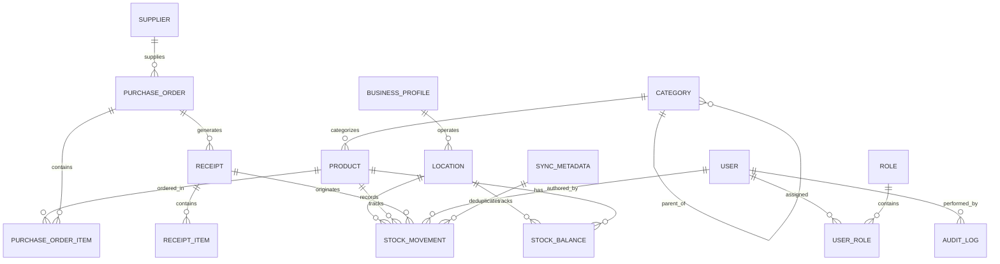

# UNIFLOW — Database Design & Inventory Ledger Specification

## 1. Overview & Core Philosophy
Uniflow relies on **PostgreSQL** as its single authoritative datastore. The database schema is engineered with a strict **ledger-first** philosophy:

1. **The Ledger is the Truth**: Every stock change (opening balance, receiving, adjustment, issue, transfer) is an immutable row in the `StockMovement` table.
2. **Stock Balance is a Transactional Projection**: `StockBalance` stores the current stock level per product and location for high-performance reads, but it is updated **atomically** in the same database transaction as the movement entry.
3. **No Direct Balance Overwrites**: Application code and API clients are forbidden from issuing `UPDATE stock_balance SET current_quantity = X`. Balances only change as a side effect of recording a validated `StockMovement`.
4. **Negative Stock Policy**: Negative stock is rejected by default. The database transactions enforce non-negative balances under row-level locks.
5. **Exact Financial Precision**: All monetary values (`purchase_cost`, `selling_price`, `unit_cost`, `line_total`) use PostgreSQL `numeric(14, 4)` or `numeric(12, 2)` to eliminate floating-point calculation errors.

---

## 2. Entity-Relationship Diagram (ERD)



---

## 3. Core Entities & Table Definitions

### 3.1 Organization & Location

#### `business_profile`
Stores installation-level metadata for the single business instance.
| Field | Type | Constraints | Description |
| :--- | :--- | :--- | :--- |
| `id` | `uuid` | `PRIMARY KEY` | Default installation UUID |
| `name` | `varchar(255)` | `NOT NULL` | Business legal/trading name |
| `currency_code` | `varchar(3)` | `NOT NULL, DEFAULT 'USD'` | ISO 4217 standard currency |
| `timezone` | `varchar(64)` | `NOT NULL, DEFAULT 'UTC'` | Local timezone (e.g. `America/New_York`) |
| `allow_negative_stock` | `boolean` | `NOT NULL, DEFAULT FALSE` | System-wide negative stock flag |
| `created_at` | `timestamptz` | `NOT NULL, DEFAULT NOW()` | Record timestamp |
| `updated_at` | `timestamptz` | `NOT NULL, DEFAULT NOW()` | Record timestamp |

#### `location`
Physical or logical warehouse/room tracking stock balances.
| Field | Type | Constraints | Description |
| :--- | :--- | :--- | :--- |
| `id` | `uuid` | `PRIMARY KEY` | Location UUID |
| `code` | `varchar(32)` | `NOT NULL, UNIQUE` | Unique short code (e.g. `MAIN-WH`, `FRONT-STORE`) |
| `name` | `varchar(255)` | `NOT NULL` | Descriptive location name |
| `is_active` | `boolean` | `NOT NULL, DEFAULT TRUE` | Active operational status |
| `created_at` | `timestamptz` | `NOT NULL, DEFAULT NOW()` | Record timestamp |
| `updated_at` | `timestamptz` | `NOT NULL, DEFAULT NOW()` | Record timestamp |

---

### 3.2 Product Catalog

#### `category`
Hierarchical product categorization.
| Field | Type | Constraints | Description |
| :--- | :--- | :--- | :--- |
| `id` | `uuid` | `PRIMARY KEY` | Category UUID |
| `name` | `varchar(128)` | `NOT NULL` | Category name |
| `slug` | `varchar(160)` | `NOT NULL, UNIQUE` | URL-safe identifier |
| `parent_id` | `uuid` | `NULL, FK(category.id)` | Optional parent for subcategories |
| `description` | `text` | `DEFAULT ''` | Optional notes |
| `is_active` | `boolean` | `NOT NULL, DEFAULT TRUE` | Visibility flag |
| `created_at` | `timestamptz` | `NOT NULL, DEFAULT NOW()` | Record timestamp |
| `updated_at` | `timestamptz` | `NOT NULL, DEFAULT NOW()` | Record timestamp |

#### `product`
Master record of inventory items.
| Field | Type | Constraints | Description |
| :--- | :--- | :--- | :--- |
| `id` | `uuid` | `PRIMARY KEY` | Product UUID |
| `sku` | `varchar(64)` | `NOT NULL, UNIQUE` | Stock Keeping Unit (strictly unique) |
| `barcode` | `varchar(64)` | `NULL, UNIQUE` | Barcode (EAN, UPC) unique when present |
| `name` | `varchar(255)` | `NOT NULL` | Product title |
| `description` | `text` | `DEFAULT ''` | Detailed product specifications |
| `category_id` | `uuid` | `NOT NULL, FK(category.id)` | Associated category |
| `unit_of_measure` | `varchar(32)` | `NOT NULL, DEFAULT 'unit'` | e.g., `unit`, `box`, `kg`, `liter` |
| `purchase_cost` | `numeric(14, 4)` | `NOT NULL, DEFAULT 0` | Baseline purchase/replacement cost |
| `selling_price` | `numeric(14, 4)` | `NOT NULL, DEFAULT 0` | Default sales price |
| `reorder_threshold` | `numeric(12, 2)` | `NOT NULL, DEFAULT 0` | Minimum quantity before alert |
| `is_active` | `boolean` | `NOT NULL, DEFAULT TRUE` | Active for business transactions |
| `archived_at` | `timestamptz` | `NULL` | Soft deletion timestamp |
| `created_at` | `timestamptz` | `NOT NULL, DEFAULT NOW()` | Record timestamp |
| `updated_at` | `timestamptz` | `NOT NULL, DEFAULT NOW()` | Record timestamp |

---

### 3.3 Authoritative Inventory Ledger & Balances

#### `stock_movement` (The Ledger)
Immutable audit trail of every quantity change. **Never modified or deleted.**
| Field | Type | Constraints | Description |
| :--- | :--- | :--- | :--- |
| `id` | `uuid` | `PRIMARY KEY` | Unique movement ID |
| `movement_reference`| `varchar(64)` | `NOT NULL, UNIQUE` | Human-readable ref (e.g. `MOV-2026-000123`) |
| `product_id` | `uuid` | `NOT NULL, FK(product.id)` | Affected product |
| `location_id` | `uuid` | `NOT NULL, FK(location.id)` | Affected storage location |
| `movement_type` | `varchar(32)` | `NOT NULL` | See Movement Types enum below |
| `quantity` | `numeric(12, 2)` | `NOT NULL` | Signed quantity change (+ for add, - for issue) |
| `unit_cost` | `numeric(14, 4)` | `NOT NULL, DEFAULT 0` | Cost of unit at time of movement |
| `source_doc_type` | `varchar(64)` | `NULL` | e.g., `RECEIPT`, `ADJUSTMENT`, `TRANSFER` |
| `source_doc_id` | `uuid` | `NULL` | UUID of originating transaction document |
| `reason` | `varchar(255)` | `NOT NULL` | Business justification or reason code |
| `actor_id` | `uuid` | `NOT NULL, FK(user.id)` | User who executed the action |
| `reversal_of_id` | `uuid` | `NULL, FK(stock_movement.id)`| Target movement if this is a compensating reversal |
| `effective_at` | `timestamptz` | `NOT NULL, DEFAULT NOW()` | Business effective timestamp |
| `created_at` | `timestamptz` | `NOT NULL, DEFAULT NOW()` | System creation timestamp |

**Permitted `movement_type` Values**:
- `OPENING_BALANCE`: Initial stock setup.
- `RECEIPT`: Goods received from a supplier purchase order.
- `ISSUE`: Stock consumed, sold, or disposed of.
- `POSITIVE_ADJUSTMENT`: Cycle count upward correction.
- `NEGATIVE_ADJUSTMENT`: Cycle count downward correction.
- `TRANSFER_OUT`: Outbound half of a multi-location transfer.
- `TRANSFER_IN`: Inbound half of a multi-location transfer.
- `REVERSAL`: Compensating transaction reversing a posted movement.

#### `stock_balance` (Projected Read Cache)
Transactionally maintained projection for zero-latency queries.
| Field | Type | Constraints | Description |
| :--- | :--- | :--- | :--- |
| `id` | `uuid` | `PRIMARY KEY` | Balance record UUID |
| `product_id` | `uuid` | `NOT NULL, FK(product.id)` | Linked product |
| `location_id` | `uuid` | `NOT NULL, FK(location.id)` | Linked location |
| `current_quantity` | `numeric(12, 2)` | `NOT NULL, DEFAULT 0` | Current on-hand quantity |
| `last_movement_id` | `uuid` | `NULL, FK(stock_movement.id)`| Most recent movement applied |
| `updated_at` | `timestamptz` | `NOT NULL, DEFAULT NOW()` | Last update timestamp |

**Indexes & Constraints**:
- `UNIQUE (product_id, location_id)`: Guarantees exactly one balance record per product and location.
- `CHECK (current_quantity >= 0 OR allow_negative)`: Optional database-level guard.

---

### 3.4 Suppliers & Purchasing

#### `supplier`
Vendor records for ordering raw materials or resale products.
| Field | Type | Constraints | Description |
| :--- | :--- | :--- | :--- |
| `id` | `uuid` | `PRIMARY KEY` | Supplier UUID |
| `name` | `varchar(255)` | `NOT NULL` | Supplier company name |
| `contact_name` | `varchar(128)` | `DEFAULT ''` | Primary representative |
| `email` | `varchar(254)` | `DEFAULT ''` | Purchasing contact email |
| `phone` | `varchar(32)` | `DEFAULT ''` | Telephone number |
| `address` | `text` | `DEFAULT ''` | Physical/mailing address |
| `is_active` | `boolean` | `NOT NULL, DEFAULT TRUE` | Active vendor status |
| `created_at` | `timestamptz` | `NOT NULL, DEFAULT NOW()` | Record timestamp |
| `updated_at` | `timestamptz` | `NOT NULL, DEFAULT NOW()` | Record timestamp |

#### `purchase_order`
Formal procurement orders sent to suppliers.
| Field | Type | Constraints | Description |
| :--- | :--- | :--- | :--- |
| `id` | `uuid` | `PRIMARY KEY` | Purchase order UUID |
| `order_reference` | `varchar(64)` | `NOT NULL, UNIQUE` | e.g., `PO-2026-00045` |
| `supplier_id` | `uuid` | `NOT NULL, FK(supplier.id)` | Target supplier |
| `status` | `varchar(32)` | `NOT NULL, DEFAULT 'DRAFT'`| `DRAFT`, `SUBMITTED`, `PARTIALLY_RECEIVED`, `FULLY_RECEIVED`, `CANCELLED` |
| `order_date` | `date` | `NOT NULL, DEFAULT CURRENT_DATE` | Date issued |
| `expected_date` | `date` | `NULL` | Anticipated delivery |
| `notes` | `text` | `DEFAULT ''` | Order instructions |
| `created_by_id` | `uuid` | `NOT NULL, FK(user.id)` | Order author |
| `created_at` | `timestamptz` | `NOT NULL, DEFAULT NOW()` | Record timestamp |
| `updated_at` | `timestamptz` | `NOT NULL, DEFAULT NOW()` | Record timestamp |

#### `purchase_order_item`
Line items within a purchase order.
| Field | Type | Constraints | Description |
| :--- | :--- | :--- | :--- |
| `id` | `uuid` | `PRIMARY KEY` | Line item UUID |
| `purchase_order_id`| `uuid` | `NOT NULL, FK(purchase_order.id)` | Parent purchase order |
| `product_id` | `uuid` | `NOT NULL, FK(product.id)` | Ordered product |
| `ordered_quantity` | `numeric(12, 2)` | `NOT NULL` | Units requested |
| `received_quantity`| `numeric(12, 2)` | `NOT NULL, DEFAULT 0` | Units accepted to date |
| `unit_cost` | `numeric(14, 4)` | `NOT NULL` | Locked unit cost at order time |
| `line_total` | `numeric(14, 4)` | `NOT NULL` | Calculated: `ordered_quantity * unit_cost` |

#### `receipt`
A physical delivery intake against a purchase order.
| Field | Type | Constraints | Description |
| :--- | :--- | :--- | :--- |
| `id` | `uuid` | `PRIMARY KEY` | Receipt UUID |
| `receipt_reference`| `varchar(64)` | `NOT NULL, UNIQUE` | Delivery note number / intake reference |
| `purchase_order_id`| `uuid` | `NOT NULL, FK(purchase_order.id)` | Parent PO |
| `status` | `varchar(32)` | `NOT NULL, DEFAULT 'POSTED'` | `DRAFT`, `POSTED`, `CANCELLED` |
| `supplier_delivery_ref` | `varchar(128)` | `DEFAULT ''` | Supplier's waybill / invoice number |
| `received_by_id` | `uuid` | `NOT NULL, FK(user.id)` | Receiving warehouse staff |
| `received_at` | `timestamptz` | `NOT NULL, DEFAULT NOW()` | Intake timestamp |

#### `receipt_item`
Line-item breakdown of received quantities.
| Field | Type | Constraints | Description |
| :--- | :--- | :--- | :--- |
| `id` | `uuid` | `PRIMARY KEY` | Receipt item UUID |
| `receipt_id` | `uuid` | `NOT NULL, FK(receipt.id)` | Parent intake receipt |
| `po_item_id` | `uuid` | `NOT NULL, FK(purchase_order_item.id)`| Target PO item |
| `accepted_quantity`| `numeric(12, 2)` | `NOT NULL` | Quantity accepted into stock |
| `rejected_quantity`| `numeric(12, 2)` | `NOT NULL, DEFAULT 0` | Damaged or rejected quantity |
| `notes` | `varchar(255)` | `DEFAULT ''` | Condition notes |

---

### 3.5 Synchronization & Audit

#### `sync_metadata` (Server Idempotency Store)
Guarantees offline outbox operations are processed strictly once.
| Field | Type | Constraints | Description |
| :--- | :--- | :--- | :--- |
| `client_operation_id` | `uuid` | `PRIMARY KEY` | Client-generated UUIDv4 |
| `operation_type` | `varchar(64)` | `NOT NULL` | e.g. `POST_RECEIPT`, `STOCK_ADJUSTMENT` |
| `actor_id` | `uuid` | `NOT NULL, FK(user.id)` | Submitting authenticated user |
| `status` | `varchar(32)` | `NOT NULL` | `COMMITTED`, `REJECTED` |
| `result_payload` | `jsonb` | `NOT NULL` | Cached server response returned on retry |
| `error_message` | `text` | `DEFAULT ''` | Rejection details if invalid |
| `created_at` | `timestamptz` | `NOT NULL, DEFAULT NOW()` | Initial receipt timestamp |
| `processed_at` | `timestamptz` | `NOT NULL, DEFAULT NOW()` | Server completion timestamp |

#### `audit_log`
System-wide security and compliance event tracking.
| Field | Type | Constraints | Description |
| :--- | :--- | :--- | :--- |
| `id` | `bigserial` | `PRIMARY KEY` | Auto-incrementing log ID |
| `actor_id` | `uuid` | `NULL, FK(user.id)` | User who triggered the event |
| `action` | `varchar(64)` | `NOT NULL` | e.g. `PRODUCT_ARCHIVED`, `ROLE_MODIFIED` |
| `entity_type` | `varchar(64)` | `NOT NULL` | Affected model name |
| `entity_id` | `varchar(64)` | `NOT NULL` | Affected record ID |
| `before_state` | `jsonb` | `NULL` | Pre-change snapshot (no secrets) |
| `after_state` | `jsonb` | `NULL` | Post-change snapshot (no secrets) |
| `ip_address` | `inet` | `NULL` | Client IP |
| `created_at` | `timestamptz` | `NOT NULL, DEFAULT NOW()` | Timestamp |

---

## 4. Transactional Invariants & Concurrency Protocols

### 4.1 The Atomic Balance Mutation Protocol
Whenever an operation alters inventory:
```python
with transaction.atomic():
    # 1. Acquire row-level lock on the StockBalance row
    balance, created = StockBalance.objects.select_for_update().get_or_create(
        product=product,
        location=location,
        defaults={'current_quantity': Decimal('0')}
    )
    
    # 2. Check negative-stock rule
    new_quantity = balance.current_quantity + movement_delta
    if new_quantity < 0 and not settings.ALLOW_NEGATIVE_STOCK:
        raise InsufficientStockError(
            f"Stock for {product.sku} at {location.code} would drop below zero."
        )
        
    # 3. Create immutable StockMovement entry
    movement = StockMovement.objects.create(
        movement_reference=generate_unique_ref(),
        product=product,
        location=location,
        movement_type=movement_type,
        quantity=movement_delta,
        unit_cost=unit_cost,
        source_doc_type=source_type,
        source_doc_id=source_id,
        reason=reason,
        actor=request.user
    )
    
    # 4. Update the projected balance atomically
    balance.current_quantity = new_quantity
    balance.last_movement = movement
    balance.save(update_fields=['current_quantity', 'last_movement', 'updated_at'])
```

### 4.2 Idempotency Gate for Receipts & Sync Operations
Before executing any state change with a `client_operation_id`:
1. Check `SyncMetadata.objects.filter(client_operation_id=operation_id).first()`.
2. If found with `status='COMMITTED'`, return the stored `result_payload` immediately with HTTP `200 OK` without creating duplicate ledger records.
3. If not found, open a `transaction.atomic()`, execute the mutation, record the `SyncMetadata` entry, and commit.
