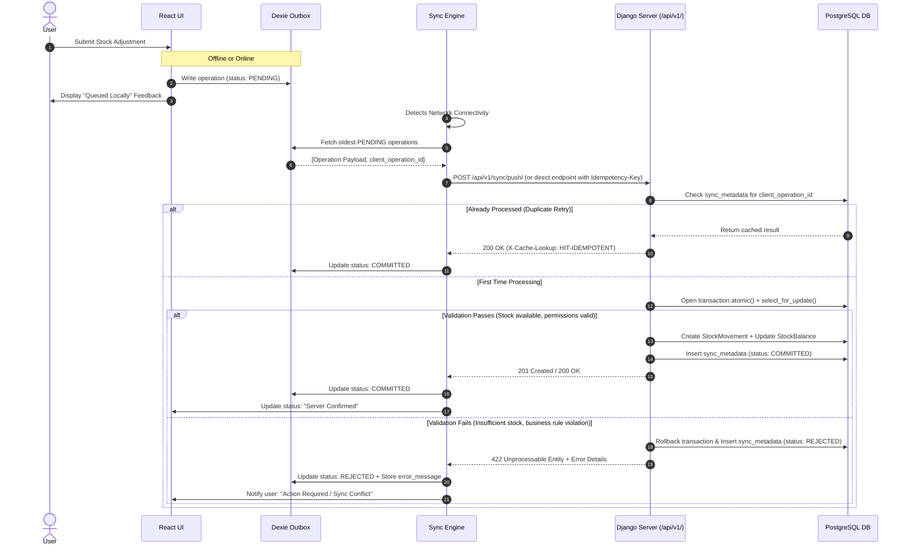

# UNIFLOW — Offline-First Storage & Synchronization Protocol

## 1. Overview & Operating Principles

Offline operation is a mandatory requirement for Uniflow IMS. Businesses operating in areas with unstable local connectivity must be able to continue recording stock adjustments, draft purchase orders, and receiving goods without downtime or data corruption.

### 1.1 Fundamental Offline Principles
1. **The Server is Authoritative**: Client devices maintain local replicas of catalog data and an outbox queue of pending changes. However, the server's PostgreSQL database remains the sole arbiter of true inventory balances and posted transactions.
2. **Operations, Not Balances**: Clients never synchronize by overwriting server balances with local calculations. Clients submit **typed business intents** (e.g. `STOCK_ADJUSTMENT`, `POST_RECEIPT`) with signed deltas and reasons.
3. **Durable Local Outbox**: All mutations performed while offline are immediately written to IndexedDB before any UI confirmation is displayed. They survive browser closures, reloads, and device restarts.
4. **Permanent Client Operation IDs**: Every mutation receives a unique client-generated UUIDv4 (`client_operation_id`) created at the exact moment the user hits submit. This ID is preserved across all retries.
5. **No Silent Overwrites or Silent Drops**: Conflicting or invalid offline operations are never silently discarded. If an operation fails server revalidation (e.g., stock was depleted by another user while offline), it is flagged as `REJECTED` with an actionable reason for user intervention.

---

## 2. Connectivity States

Uniflow distinguishes four discrete operating states:

```
┌────────────────────────────────────────────────────────────────────────┐
│                        UNIFLOW CONNECTIVITY MODES                      │
├──────────────────────────┬─────────────────────────────────────────────┤
│ 1. Fully Connected       │ Standard operation. Mutations post directly │
│                          │ to /api/v1/ and mirror to local IndexedDB.  │
├──────────────────────────┼─────────────────────────────────────────────┤
│ 2. LAN Online /          │ Business computer reaches local server;     │
│    Cloud Offline         │ external internet is down. Full system works│
│                          │ normally without degradation.               │
├──────────────────────────┼─────────────────────────────────────────────┤
│ 3. Disconnected Client   │ Local server unreachable. Client switches to│
│    (Offline Mode)        │ IndexedDB cache and queues mutations into   │
│                          │ the durable local outbox.                   │
├──────────────────────────┼─────────────────────────────────────────────┤
│ 4. Reconnecting / Sync   │ Network restored. Background engine replays │
│                          │ outbox queue sequentially with idempotency. │
└──────────────────────────┴─────────────────────────────────────────────┘
```

---

## 3. Client Storage Architecture (Dexie.js / IndexedDB)

The frontend uses **Dexie.js** to manage IndexedDB storage across distinct operational stores:

```
IndexedDB: `uniflow_offline_db`
├── products_cache          (Read replica of catalog for search & selection)
├── categories_cache        (Hierarchical categories for filtering)
├── locations_cache         (Available storage locations)
├── balances_cache          (Latest confirmed stock balances per location)
├── suppliers_cache         (Active suppliers for purchase orders)
├── outbox_operations       (Durable queue of pending/failed user mutations)
└── sync_state              (High-water mark timestamps & connectivity meta)
```

### 3.1 `outbox_operations` Schema
The outbox stores all mutations initiated on the client:

| Field | Type | Description |
| :--- | :--- | :--- |
| `client_operation_id` | `string` (UUID) | Primary Key. Client-generated UUIDv4. |
| `operation_type` | `string` | e.g. `STOCK_ADJUSTMENT`, `STOCK_ISSUE`, `CREATE_PO`, `POST_RECEIPT` |
| `endpoint` | `string` | Target API path (e.g. `/api/v1/inventory/adjustments/`) |
| `payload` | `object` | Complete JSON payload matching server contract |
| `created_at` | `string` (ISO) | Client timestamp when user submitted |
| `status` | `string` | `PENDING`, `SYNCING`, `COMMITTED`, `REJECTED` |
| `retry_count` | `number` | Number of failed network transmission attempts |
| `error_code` | `string` | Optional machine error code returned from server |
| `error_message` | `string` | Human-readable explanation if rejected |
| `user_id` | `string` | Authenticated user who performed the action |

---

## 4. Synchronization Lifecycle & Protocol

### 4.1 The Push Lifecycle (Client ➔ Server)



### 4.2 The Pull Lifecycle (Server ➔ Client)
To ensure the offline catalog stays current:
1. Client sends periodic or reconnect query:
   ```http
   GET /api/v1/sync/pull/?since=2026-10-15T18:00:00Z
   ```
2. Server responds with changed records since the provided timestamp:
   ```json
   {
     "server_timestamp": "2026-10-15T20:20:00Z",
     "categories": [ ... ],
     "products": [ ... ],
     "locations": [ ... ],
     "balances": [ ... ]
   }
   ```
3. Client updates local IndexedDB tables in a single transaction and advances its local `sync_state.last_pull_at` cursor.

---

## 5. Conflict Resolution Matrix

Different domain entities require distinct conflict strategies:

| Entity / Action | Conflict Scenario | Resolution Policy |
| :--- | :--- | :--- |
| **Product Information** | Concurrent edits to product description or price. | **Server-Authoritative with Version Check**: If client version matches server version, update applies. Otherwise, client is notified to review server state. |
| **Product SKU / Barcode** | Client creates a product with an SKU already taken online. | **Server Enforced Uniqueness**: Server rejects with `409 Conflict`. Outbox operation marked `REJECTED`. User must edit SKU to resolve. |
| **Draft Purchase Orders**| Concurrent edits to a draft order. | **Merge / Latest Edit**: Drafts permit iterative edits before submission. |
| **Receipt Intake** | Client submits receipt intake for PO item already received. | **Server Re-validation**: Server checks remaining expected quantity. If exceeded, partial acceptance or rejection is returned. |
| **Stock Deductions / Adjustments** | Offline stock issue where stock was depleted online during disconnect. | **Strict Server Validation**: Server rejects operation if balance would violate negative stock policy. Operation remains in Outbox as `REJECTED`. User must perform a cycle count or adjust requested quantity. |

> **CORE GUARANTEE**: Inventory balances are **never** reconciled using Last-Write-Wins (LWW). Stale client balances are forbidden from replacing server values.

---

## 6. User Interface & Error Handling Experience

### 6.1 Status Indicators
The UI header displays an active connectivity and synchronization widget:
- 🟢 **Online**: Server connected; all local changes confirmed.
- 🟡 **Offline (N Pending)**: Operating on local data; N changes queued in outbox.
- 🔄 **Syncing**: Outbox actively pushing changes to the server.
- 🔴 **Sync Alert (N Rejected)**: One or more operations failed server revalidation and require user review.

### 6.2 The Pending Operations Screen (`/settings/outbox/`)
Users can open an inspection dashboard showing:
1. List of pending, syncing, and committed items.
2. List of rejected items with clear error messages (e.g. *"Insufficient Stock: Product SKU-100 only has 2 units remaining; attempted to deduct 5"*).
3. Actions per rejected item:
   - **Edit & Retry**: Update parameters (e.g., adjust quantity) and re-queue.
   - **Discard**: Remove the invalid mutation from the outbox.
